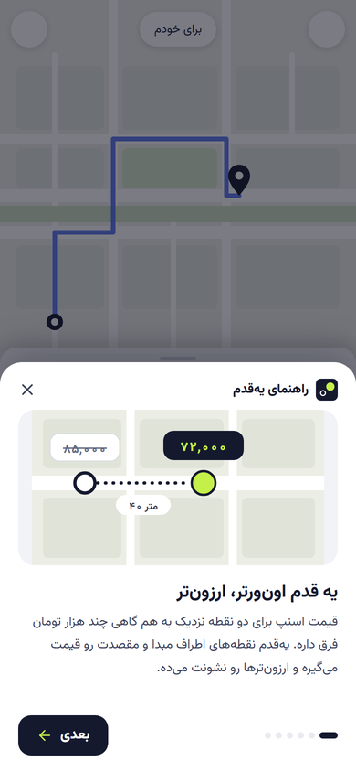
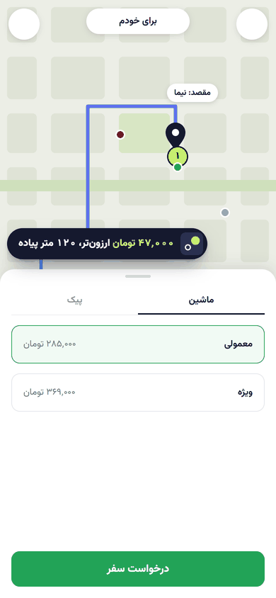

<p align="center">
  
</p>

<p align="center">
  <a href="../../releases/latest"></a>
  <a href="../../actions/workflows/ci.yml"></a>
  <a href="LICENSE"></a>
</p>

<p align="center"><sub><b>English:</b> Yeghadam finds a cheaper pickup or drop-off point a few steps away in the Snapp and Tapsi web apps. It asks the service for prices of nearby points you can really walk to and shows a few short suggestions. Unofficial, no server, and it never requests a ride. Android app and browser extension; see <a href="#development">Development</a>.</sub></p>

<div dir="rtl">

# یه‌قدم

**یه قدم اون‌ورتر، ارزون‌تر.**

قیمت اسنپ و تپسی فقط به مسیر بستگی ندارد؛ نقطه‌ی دقیق سوار و پیاده شدن هم مهم است. اون‌ور خیابان، سر کوچه‌ی بعدی یا چند ده متر جلوتر، گاهی همان سفر چند ده هزار تومان ارزان‌تر است.
یه‌قدم داخل خود وب‌اپ اسنپ یا تپسی کار می‌کند: نقاط نزدیکی را که واقعاً می‌شود پیاده تا آن‌ها رفت قیمت می‌گیرد و چند پیشنهاد کوتاه نشانت می‌دهد.

> یه‌قدم برنامه‌ای غیررسمی است و هیچ ارتباطی با اسنپ و تپسی ندارد. فقط قیمت می‌پرسد و هرگز سفری ثبت نمی‌کند.

<p align="center">
  
  
  
  
  
</p>
<p align="center"><sub>تصاویر نمونه‌اند؛ قیمت و خیابان‌ها برای نمایش انتخاب شده‌اند.</sub></p>

## چطور کار می‌کند

1. در اسنپ یا تپسی مبدا و مقصد را انتخاب کن تا قیمت بیاید، بعد روی **«ارزون‌ترش کن»** بزن.
2. بگو امروز تا کجا حاضری پیاده بروی، برای مبدا و مقصد جدا: ۱۰۰، ۲۰۰ یا ۳۰۰ متر. ماشین یا موتور.
3. چند ثانیه بعد، حداکثر سه پیشنهاد می‌بینی: چقدر ارزان‌تر، چند متر پیاده، کجا.
4. روی **«اعمال»** بزن. در اسنپ پین به همان نقطه می‌رود و خودش تأیید می‌شود (اگر تأیید نشد، روی پین بزن)؛ در تپسی خود صفحه با نقطه‌ی جدید باز می‌شود. بعد پیاده تا نقطه‌ی جدید برو.
5. اگر اجازه بدهی، قیمت همان مسیر در سرویس دیگر هم کنار پیشنهادها نشان داده می‌شود و **«برو به تپسی»** (یا اسنپ) همان مسیر را آن‌جا باز می‌کند.

بار اول یک راهنمای هفت‌قدمی همین‌ها را با تصویر نشان می‌دهد و هر وقت خواستی با دکمه‌ی **؟** بالای پنل دوباره باز می‌شود.

<p align="center"></p>

## امکانات

- **فقط جاهایی که می‌شود رفت.** نقاط روی خیابان‌هایی انتخاب می‌شوند که ماشین می‌تواند آنجا بایستد؛ نه وسط بزرگراه، نه داخل تونل، نه روی رمپ.
- **فاصله‌ی پیاده‌روی واقعی** روی شبکه‌ی خیابان‌ها، با عبور از عرض بلوار؛ نه خط هوایی.
- **اون‌ور خیابان** روی بلوارهای دوطرفه همیشه بررسی می‌شود؛ معمولاً مسیر راننده را عوض می‌کند.
- **اسنپ و تپسی،** ماشین یا موتور، هر جا سرویس آن را برای مسیرت ارائه کند.
- **فاصله‌ی جدا برای مبدا و مقصد.** مثلاً از مبدا ۱۰۰ متر و از مقصد ۳۰۰ متر. با «همین‌جا» یکی از دو سر سر جایش می‌ماند و همه‌ی استعلام‌ها برای سر دیگر خرج می‌شود.
- **قیمت یک نقطه‌ی دلخواه:** انگشتت را روی نقشه نگه دار (در کامپیوتر: کلیک راست).
- **مقایسه‌ی دو سرویس.** با اجازه‌ی خودت، قیمت همین مسیر در سرویس دیگر کنار قیمت فعلی می‌آید و می‌گوید چقدر ارزان‌تر یا گران‌تر است. هر صفحه فقط با سرویس خودش حرف می‌زند؛ جواب سرویس دیگر را صفحه‌ی خودش می‌دهد، با حساب خودت.
- **عوض کردن سرویس بدون دردسر.** در اپ اندروید دو تب «اسنپ | تپسی» بالای صفحه است و هر کدام صفحه‌ی خودش را نگه می‌دارد. «برو به تپسی/اسنپ» مسیر را همراه می‌برد.
- **قفل قیمت (اسنپ):** اسنپ هر قیمت را چند دقیقه ثابت نگه می‌دارد. یه‌قدم این را تشخیص می‌دهد و می‌گوید جابه‌جا شدن به نفعت هست یا نه.

## نصب

**اندروید:** فایل `yeghadam-x.y.z.apk` را از بخش [Releases](../../releases) دانلود و نصب کن، بار اول مقدمه و اعلان «غیررسمی» را می‌بینی و باید قبولش کنی، بعد سرویس (اسنپ یا تپسی) را انتخاب می‌کنی و با حساب خودت وارد می‌شوی. بعداً با نوار «اسنپ | تپسی» بالای صفحه سرویس را عوض کن؛ برنامه با آخرین سرویس باز می‌شود.

**کروم، اج و مرورگرهای کرومیوم:**
1. فایل `yeghadam-extension-x.y.z.zip` را از [Releases](../../releases) دانلود و از حالت فشرده خارج کن.
2. به `chrome://extensions` برو و **Developer mode** را روشن کن.
3. **Load unpacked** را بزن و پوشه‌ی باز شده را انتخاب کن.
4. در [app.snapp.taxi](https://app.snapp.taxi) یا [app.tapsi.cab](https://app.tapsi.cab) مبدا و مقصد را انتخاب کن و روی «ارزون‌ترش کن» بزن. بعد از هر بار نصب یا به‌روزرسانی افزونه، تب‌های باز اسنپ و تپسی را یک بار رفرش کن.

**فایرفاکس ۱۲۸ به بعد:** در `about:debugging#/runtime/this-firefox` روی **Load Temporary Add-on** بزن و `manifest.json` داخل پوشه‌ی `dist/extension-firefox` را انتخاب کن (فایرفاکس پس‌زمینه‌ی سرویس‌ورکر ندارد، پس نسخه‌ی خودش را می‌خواهد).

## محدودیت‌ها

- **غیررسمی است.** اسنپ و تپسی ممکن است API یا صفحه‌شان را عوض کنند و یه‌قدم تا آپدیت کار نکند. نسخه‌ی تازه را از [Releases](../../releases) بگیر.
- **قیمت نهایی را خود سرویس می‌گوید.** قیمت‌ها در چند دقیقه عوض می‌شوند (در تپسی هر یک دقیقه). یه‌قدم وقتی قیمت جابه‌جا شود خبرت می‌کند، ولی تضمین صرفه نمی‌دهد.
- **ریسک حساب.** بعید است، ولی ممکن است سرویس استعلام خودکار را خلاف قوانینش بدانند. برای همین تعداد جستجوها محدود است.
- **سفر را خودت ثبت می‌کنی.** یه‌قدم هیچ‌وقت سفر درخواست نمی‌دهد.

## سوال‌های پرتکرار

**با «همین‌جا» چه می‌شود؟** آن سر (مبدا یا مقصد) جابه‌جا نمی‌شود و همه‌ی استعلام‌ها برای سر دیگر خرج می‌شود.

**چرا بعضی وقت‌ها صرفه‌ای پیدا نمی‌شود؟** شب‌ها و مسیرهای خلوت قیمت نقاط اطراف تقریباً یکی است. ساعت‌های شلوغ و بلوارهای دوطرفه معمولاً نتیجه‌ی بهتری دارند.

**سرویس را چطور عوض کنم؟** در اپ اندروید روی «اسنپ» یا «تپسی» بالای صفحه بزن. در مرورگر کافی است سایت دیگر را در یک تب دیگر باز کنی؛ لینک «برو به …» در پنل همین کار را با همان مسیر می‌کند.

**قیمت سرویس دیگر چطور گرفته می‌شود؟** اولین بار می‌پرسد. اگر بگویی «بگیر»، همان صفحه‌ی سرویس دیگر (تب دیگر یا تب دیگر اپ) با نشست خودت قیمت مسیر را می‌پرسد و جواب را برمی‌گرداند. اگر آن سرویس باز نباشد، فقط می‌گوید باز نیست و چیزی لود نمی‌کند. با «نه، لازم نیست» دیگر نمی‌پرسد.

**باگ دیدم یا پیشنهاد دارم.** در [Issues](../../issues) بنویس و توکن و آدرس واقعی‌ات را حذف کن. مشکل امنیتی را طبق [SECURITY.md](SECURITY.md) خصوصی گزارش کن.

## حریم خصوصی و امنیت حساب

یه‌قدم سرور ندارد و هیچ داده‌ای جمع نمی‌کند. با همان حسابی کار می‌کند که در اسنپ یا تپسی وارد شده‌ای و فقط با این آدرس‌ها حرف می‌زند. اگر مقایسه‌ی دو سرویس را بپذیری، مسیر (فقط نقطه‌ها) و قیمت بین دو صفحه‌ی خودت جابه‌جا می‌شود و بیرون از دستگاهت نمی‌رود:

- `app.snapp.taxi/api/v3/price` یا `api.tapsi.cab/api/v3.1/ride/preview` برای استعلام قیمت، با نشست خودت که از دستگاهت بیرون نمی‌رود؛
- `tile.snappmaps.ir` و `tap30.services` برای نقشه‌ی عمومی خیابان‌ها.

هر جستجو حداکثر ۲۵ استعلام است و تعداد جستجوها محدود است (۵ بار در ۱۰ دقیقه و ۱۵ بار در ساعت) تا حسابت به خاطر استعلام زیاد حساس نشود. جزئیات در [PRIVACY.md](PRIVACY.md).

</div>

---

## Development

Yeghadam is a script injected into the Snapp and Tapsi passenger web apps, shipped two ways: a Manifest V3 browser extension and a small Android app that hosts the web app in a WebView.

```
src/core.js        search engine, no DOM: vector tiles, walking graph, candidates, ranking (runs in Node for tests)
src/ui.js          page layer: route tracking, map overlay, panel, guided apply, price comparison with the other service
scripts/build.js   bundles both into dist/extension/ and the Android assets
extension/         extension manifest, icons, relay.js (content script) and background.js (routes messages between the two services' tabs)
android/           Android app (Java, no AndroidX); assets/start.html is the local first-run page (intro, notice, choice of service)
test/              unit tests for the core
brand/             logo source image (drawn by scripts/make-icons.py)
docs/images/       README images
```

### Tech stack

- **Core and page layer:** plain JavaScript with no runtime dependencies and no bundler. `scripts/build.js` joins `src/core.js` and `src/ui.js` into one script. Vector tiles (protobuf) are decoded by a small decoder in the core.
- **Browser extension:** Manifest V3 content script running in the page world (`world: "MAIN"`), so it can see the page's own price requests and map. Chrome, Edge and other Chromium browsers. The manifest also targets Firefox 128 or later (desktop and Android), but that has not been run yet.
- **Android app:** Java without AndroidX, built with Gradle. One `WebView` per service behind a two-tab switch (the second is created on first use) hosts Snapp or Tapsi and injects the same script; a small native bridge passes the price question between the two. minSdk 24, targetSdk 34.
- **Tests:** Node's built-in test runner (`node:test`), no test framework.
- **Releases:** GitHub Actions builds, signs and publishes the APK and the extension zip.
- **Tooling:** Python 3 with Pillow draws the icons.

### Requirements

- Node.js 22 or later
- For the Android app: JDK 17, the Android SDK (platform 34) and Gradle 8.7 or later
- To redraw icons: Python 3 with Pillow

### Commands

```bash
npm test                         # unit tests
npm run build                    # dist/extension/ and android/app/src/main/assets/yeghadam.js
gradle -p android assembleDebug  # debug APK (runs the script build first)
npm run icons                    # redraw every icon size
```

Load `dist/extension/` with **Load unpacked** to try local changes.

### How the search works

1. Road data comes from the public vector tiles the service's own map already uses (Snapp or Tapsi). Roads become a walking graph; the one-way carriageway pairs of divided roads get crossing links with a small penalty, and loose road ends left by tile simplification are joined to the road they meet.
2. Candidates are points a car can stop at (no motorways, ramps, tunnels or bridges), spread over rings of walking distance from the origin and from the destination.
3. A search spends at most 25 quotes: a spread phase on both ends, then the remaining budget steps around the best point found so far.
4. Snapp locks a quote for a few minutes per route. When the base price is older than the search, one extra quote on the same street shows the current price. Tapsi quotes expire after a minute and its page refreshes them on its own, so the panel shows the live price and warns when it moves.
5. Results are the Pareto front of walking distance against price, limited to three options.

The other service's price: each page only ever calls its own API. With the rider's consent, the page asks the shell (Android bridge, or the extension's relay and background script) to hand the route to the page of the other service, which quotes it with its own session and answers. Opening the other service carries the route: Tapsi takes it in its URL; for Snapp the script moves the map and presses Snapp's own confirm buttons on its start page.

On Snapp the route is taken from its own price requests, and only once their first and last points sit on the origin and destination markers, so previews made while dragging a pin are ignored. On Tapsi the route is read from the page URL, and applying a suggestion opens the same URL with the new point.

### Contributing

Read [CONTRIBUTING.md](CONTRIBUTING.md) first. Security problems go through [SECURITY.md](SECURITY.md). Changes per release are in [CHANGELOG.md](CHANGELOG.md).

### Releasing

The version lives in `package.json` only; the extension manifest and the Android version are derived from it.

1. Bump `version` in `package.json`, add the release to `CHANGELOG.md` and commit.
2. Tag and push: `git tag v2.1.0 && git push origin v2.1.0`.
3. The [Release workflow](.github/workflows/release.yml) tests, builds and signs the APK, zips the extension and publishes both with checksums.

The release keystore is never committed. It is stored as repository secrets: `KEYSTORE_BASE64` (`base64 -w0 release.p12`), `KEYSTORE_PASSWORD`, `KEY_ALIAS` and `KEY_PASSWORD`.

## License

[MIT](LICENSE). Not affiliated with, endorsed by or connected to Snapp or Tapsi. "Snapp" and "Tapsi" are trademarks of their owners.
